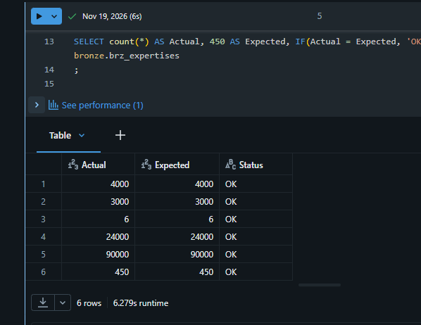
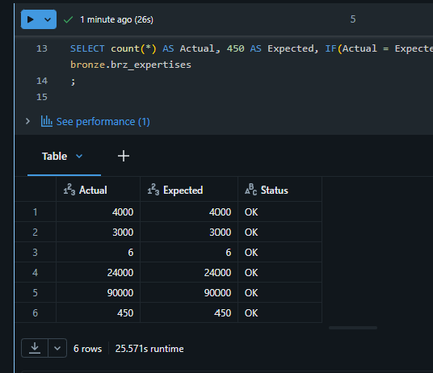
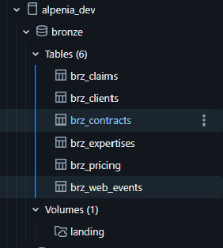
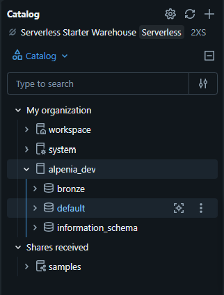
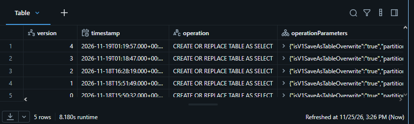

# Livrables

| Livrable | Emplacement |
|---|---|
| Notebooks `01` à `04` (+ `05_bonus`) | racine du dépôt, format `.ipynb` |
| Tables Delta `brz_` | workspace Databricks, `alpenia_dev.bronze` |
| Preuve d'idempotence | sortie de la cellule de contrôle de `02_ingestion` : [1re exécution](preuve_idempotence_1.png) (19/11/2026), [2e exécution](preuve_idempotence_2.png) (25/11/2026) |
| Capture du catalogue | [`schema_alpenia.png`](schema_alpenia.png) |
| Rapport écrit | [`rapport.md`](rapport.md) |
| Annexes | [compute et catalogue](compute_et_catalogue.png), [historique Delta](historique_delta.png) |

## Preuve d'idempotence

Ordre des lignes : `brz_contracts`, `brz_clients`, `brz_pricing`, `brz_claims`, `brz_web_events`, `brz_expertises`.

| 1re exécution | 2e exécution |
|---|---|
|  |  |

## Capture du catalogue

## Annexes

Compute de l'éditeur SQL (Serverless Starter Warehouse, 2XS) et catalogue par défaut `workspace` :

Historique Delta (`DESCRIBE HISTORY`) : une version `CREATE OR REPLACE TABLE AS SELECT` par écriture complète de la table.

